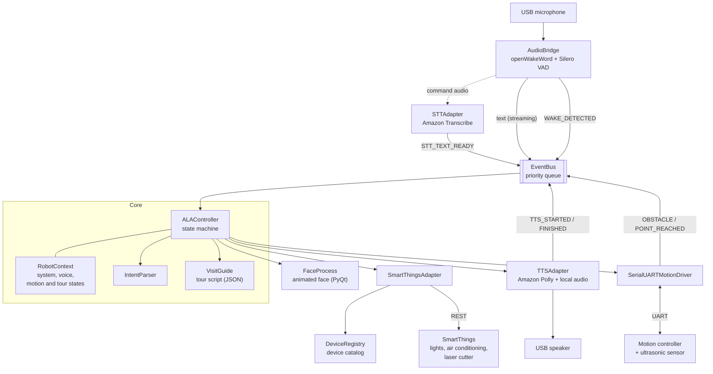
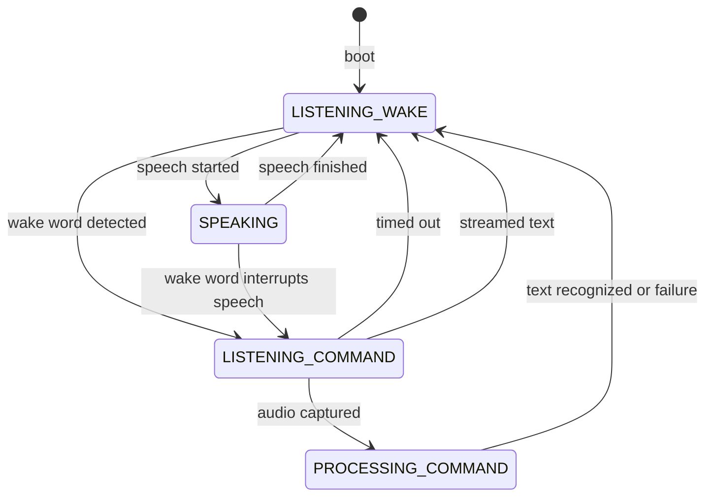
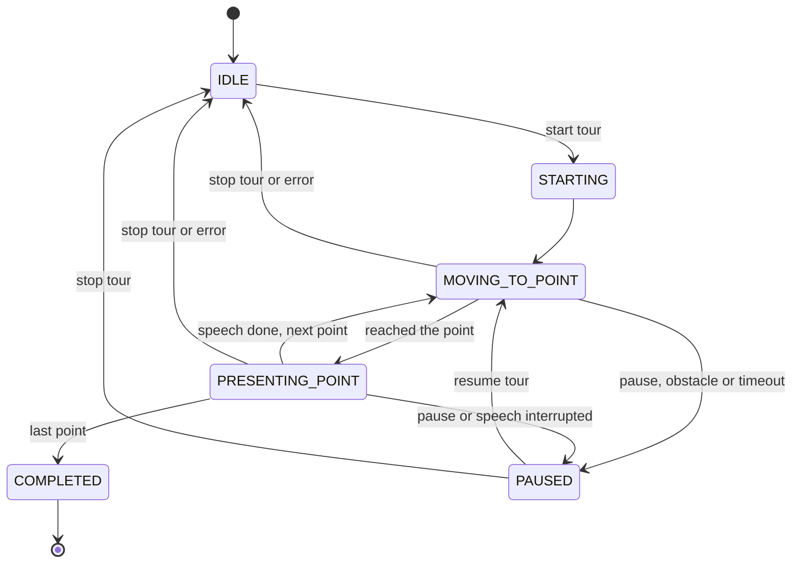
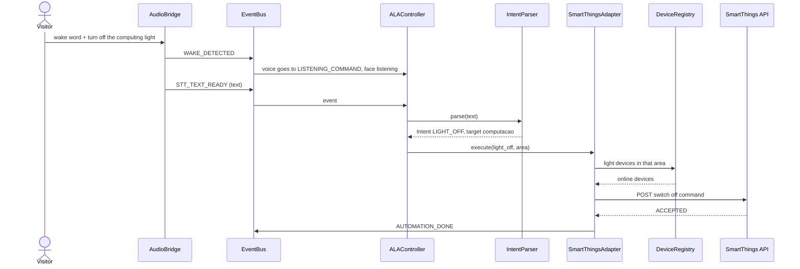

# A.L.A. — a voice-driven guide robot for the FabLab

🇧🇷 [Versão em português](README.md)

## Context

A.L.A. (Assistente Laboratorial Autônomo, "autonomous lab assistant") is a guide robot built by a team at the
digital fabrication lab (FabLab) of Samsung Ocean Center Manaus. It welcomes visitors, leads a tour through the
lab's areas (mechanics, programming and 3D printing, electronics and IoT, projects), answers voice commands in
Portuguese and controls part of the room: lights, air conditioning and the laser cutter. The goal is for visits
to happen even when nobody from the team is free to guide them, and for the robot itself to showcase what the
lab builds.

## Highlights

- **Event-driven state machine**: voice, motion, tour and system each have their own states, and every module
  talks only through an **EventBus backed by a priority queue** (error, global stop and obstacle jump ahead of
  any other event).
- **Offline wake word** (openWakeWord + Silero VAD), with the same audio flowing straight into streaming
  transcription; the robot stops talking the moment someone calls it.
- **Listening and speaking in Portuguese**: Amazon Transcribe for recognition and Amazon Polly for speech, with
  generated audio cached and the tour's lines pre-recorded so they don't depend on the network.
- **Keyword-based intents**: stop, start, pause and resume the tour, go to a point, drive and turn, plus more
  than ten room-automation commands.
- **UART navigation**: motion commands sent to the robot's controller over serial, with arrival confirmation,
  travel timeout and an **automatic stop when an obstacle is detected** (ultrasonic sensor).
- **SmartThings automation**: "turn on the management area light", "switch off the computing area", "raise the
  temperature", "turn everything off". A device catalog maps the spoken area to the right devices.
- **Animated face on the display**, running in its own process, with expressions that follow the state
  (listening, thinking, speaking, alert, error).
- **Hardware-free test modes**: inject a recognized sentence, force a line of speech, run without TTS or test
  only the automation from the command line.

## Architecture

Every adapter implements an abstract interface (`STTGateway`, `TTSGateway`, `MotionDriver`,
`AutomationGateway`), so the controller never knows the concrete implementation and each piece has a fake
stand-in for testing.

## State machine

### Voice

### Tour

The system state (`INITIALIZING`, `READY`, `ERROR`, `SHUTDOWN`) sits above everything else: an error event
stops motion before anything else happens.

### One automation command, end to end

## Stack

| Layer | Technologies |
|---|---|
| Language and core | Python 3, `threading`, `queue.PriorityQueue`, dataclasses, ABCs |
| Voice | openWakeWord + Silero VAD (wake word), Amazon Transcribe (batch via S3 and streaming), Amazon Polly (pt-BR voice) |
| Motion | Raspberry Pi, UART/serial to the motion controller, ultrasonic sensor |
| Automation | SmartThings REST API (Z-Wave lights, air conditioning, the laser cutter's Zigbee switch); earlier Home Assistant adapter |
| Interface | Animated face in PyQt, running as a subprocess driven over `stdin` |
| Tooling | CLI with simulation modes, script that pre-generates the tour audio |

## Technical decisions and challenges

- **Everything goes through the EventBus.** With microphone, serial port, network and display running on
  different threads, no module calls the controller directly. The priority queue makes sure "stop" and
  "obstacle" are handled before a recognized sentence or a finished line of speech.
- **Ports and adapters.** Every external integration has an interface and a fake. That made it possible to
  start with placeholders, swap Home Assistant for SmartThings without touching the controller, and test the
  automation with the robot switched off.
- **A device catalog instead of IDs in code.** `DeviceRegistry` reads the SmartThings export, skips anything
  offline or not controllable (cameras, hubs, groups), classifies each device as light, air conditioning or
  switch, and maps spoken nicknames ("programming", "programming area") to the right area.
- **Air conditioning with no setpoint.** The lab's unit only accepts incremental commands (one degree up, more
  fan), so the voice intents became relative commands rather than "set it to 22 degrees".
- **Voice latency.** Batch transcription (upload, then poll) was too slow for conversation. The team moved to
  keeping capture open, detecting the wake word locally and sending that same audio straight to streaming
  transcription; the fixed tour lines became pre-recorded audio.
- **Operational safety.** An obstacle or "stop" triggers a global stop (motion, speech and capture) that keeps
  the position in the tour script, so the tour resumes where it left off; a critical error stops everything
  and resets the tour.

## My role

**This is a team project.** The repository has 19 commits; **4 are mine**. What I did, checked against the history:

- **The architecture's foundation (initial commit).** The first commit, which is mine, brought in the core:
  the priority-queue EventBus, the state machine enums, `ALAController`, the intent parser, abstract interfaces
  and placeholders, configuration and the UART motion driver.
- **The first real adapters.** STT with Amazon Transcribe, TTS with Amazon Polly and an automation adapter for
  Home Assistant (later replaced).
- **The tour script.** The first version of the file with the visit script.
- **SmartThings automation and per-area voice control.** `SmartThingsAdapter`, `DeviceRegistry` with the device
  catalog and area nicknames, the new voice intents (light, air conditioning, temperature, fan, laser, whole
  area), the command-line test mode and the project README.

The rest is the work of another team member, including the offline wake word with openWakeWord + Silero VAD and
streaming transcription, the PyQt animated face, wiring the tour script into the state machine, the local tour
audio and reorganizing the tour around four physical stops.

Outside this repository, I also worked on the lab's automation with Home Assistant and infrared control (Tuya).

---

The source code is private (it belongs to the FabLab organization). This page is only a showcase of the project.
Contact: [github.com/roger-mont](https://github.com/roger-mont)
