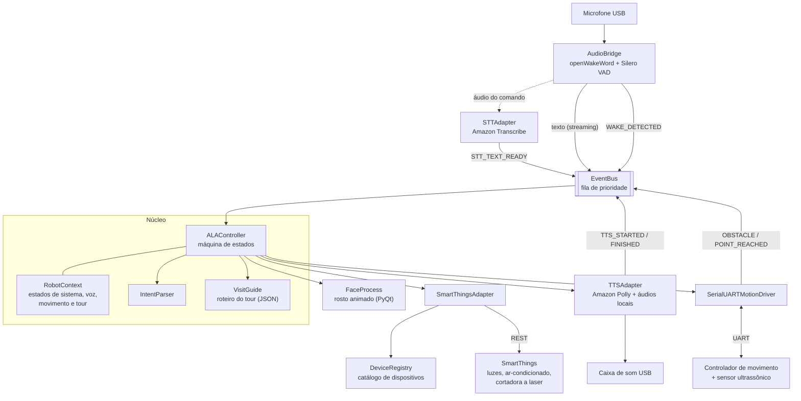
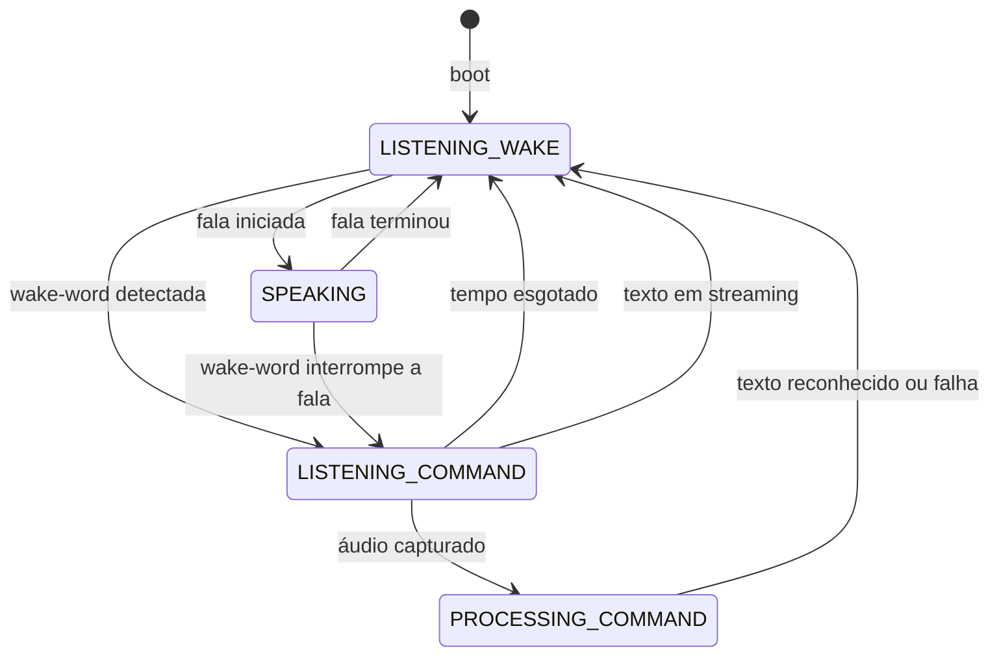
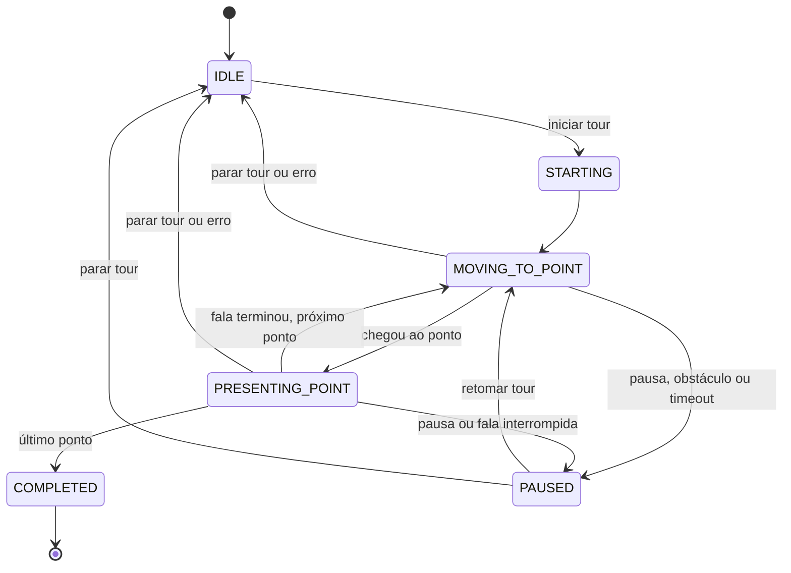
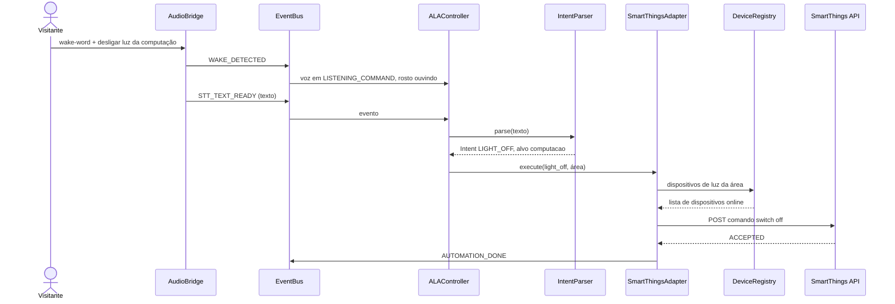

# A.L.A. — robô guia do FabLab, comandado por voz

🇺🇸 [English version](README.en.md)

## Contexto

O A.L.A. (Assistente Laboratorial Autônomo) é um robô guia construído por uma equipe no laboratório de
fabricação digital (FabLab) do Samsung Ocean Center Manaus. Ele recebe visitantes, conduz um tour pelas
áreas do laboratório (mecânica, programação e impressão 3D, elétrica e IoT, projetos), responde a comandos
de voz em português e controla parte do ambiente: luzes, ar-condicionado e a cortadora a laser. A ideia é
que a visita aconteça mesmo sem alguém da equipe disponível para guiar, e que o próprio robô sirva de
demonstração do que se faz no laboratório.

## Destaques

- **Máquina de estados orientada a eventos**: voz, movimento, tour e sistema têm estados próprios, e todos
  os módulos conversam só por um **EventBus com fila de prioridade** (erro, parada geral e obstáculo passam
  na frente de qualquer outro evento).
- **Ativação por palavra-chave offline** (openWakeWord + Silero VAD), com o mesmo áudio seguindo direto para
  a transcrição em streaming; a fala do robô é interrompida na hora quando alguém chama.
- **Fala e escuta em português**: Amazon Transcribe para reconhecimento e Amazon Polly para síntese, com
  cache dos áudios gerados e áudios do tour pré-gravados para não depender da rede.
- **Intenções por palavra-chave**: parar, iniciar, pausar e retomar o tour, ir para um ponto, andar e girar,
  e mais de dez comandos de automação ambiental.
- **Navegação por UART**: comandos de movimento para o controlador do robô pela serial, com confirmação de
  chegada ao ponto, timeout de deslocamento e **parada automática ao detectar obstáculo** (sensor ultrassônico).
- **Automação via SmartThings**: "ligar luz da gestão", "desligar a área de computação", "aumentar
  temperatura", "desligar tudo". Um catálogo de dispositivos traduz a área falada nos aparelhos certos.
- **Rosto animado no display**, em processo separado, com expressões que acompanham o estado
  (ouvindo, pensando, falando, alerta, erro).
- **Modos de teste sem hardware**: simular um texto reconhecido, forçar uma fala, rodar sem TTS ou testar só
  a automação pela linha de comando.

## Arquitetura

Todos os adaptadores implementam interfaces abstratas (`STTGateway`, `TTSGateway`, `MotionDriver`,
`AutomationGateway`), então o controlador não conhece a implementação concreta e cada peça tem um
substituto falso para testes.

## Máquina de estados

### Voz

### Tour

O estado do sistema (`INITIALIZING`, `READY`, `ERROR`, `SHUTDOWN`) fica por cima de tudo: um evento de erro
para o movimento antes de qualquer outra coisa.

### Um comando de automação, de ponta a ponta

## Stack

| Camada | Tecnologias |
|---|---|
| Linguagem e núcleo | Python 3, `threading`, `queue.PriorityQueue`, dataclasses, ABCs |
| Voz | openWakeWord + Silero VAD (ativação), Amazon Transcribe (lote via S3 e streaming), Amazon Polly (voz em pt-BR) |
| Movimento | Raspberry Pi, UART/serial para o controlador de movimento, sensor ultrassônico |
| Automação | SmartThings REST API (luzes Z-Wave, ar-condicionado, interruptor Zigbee da cortadora a laser); adaptador anterior para Home Assistant |
| Interface | Rosto animado em PyQt, rodando em subprocesso controlado por `stdin` |
| Ferramentas | CLI com modos de simulação, script de pré-geração dos áudios do tour |

## Decisões técnicas e desafios

- **Tudo passa pelo EventBus.** Com microfone, serial, rede e display rodando em threads diferentes, nenhum
  módulo chama o controlador diretamente. A fila de prioridade garante que "pare" e "obstáculo" sejam
  tratados antes de um texto reconhecido ou de uma fala terminada.
- **Portas e adaptadores.** Cada integração externa tem uma interface e um substituto falso. Isso permitiu
  começar com placeholders, trocar Home Assistant por SmartThings sem mexer no controlador e testar a
  automação sem o robô ligado.
- **Catálogo de dispositivos em vez de IDs no código.** O `DeviceRegistry` lê o export do SmartThings, ignora
  o que está offline ou não é controlável (câmeras, hubs, grupos), classifica cada aparelho como luz, ar ou
  tomada e mapeia apelidos falados ("programação", "área de programação") para a área certa.
- **Ar-condicionado sem setpoint.** O aparelho do laboratório só aceita comandos incrementais (sobe um grau,
  aumenta a ventilação), então as intenções de voz viraram comandos relativos, e não "coloque em 22 graus".
- **Latência da voz.** A transcrição em lote (upload e consulta) era lenta para conversa. A equipe passou a
  manter a captura aberta, detectar a palavra de ativação localmente e mandar o mesmo áudio direto para a
  transcrição em streaming; os textos fixos do tour viraram áudios pré-gravados.
- **Segurança operacional.** Obstáculo e "pare" levam a uma parada global (movimento, fala e captura) que
  preserva a posição no roteiro, para o tour ser retomado de onde parou; um erro crítico para tudo e
  reinicia o tour.

## Meu papel

**Este é um projeto de equipe.** O repositório tem 19 commits; **4 são meus**. O que fiz, conferido no histórico:

- **Base da arquitetura (commit inicial).** O primeiro commit, que é meu, trouxe o núcleo: EventBus com fila
  de prioridade, enums da máquina de estados, `ALAController`, parser de intenções, interfaces abstratas e
  placeholders, configuração e o driver de movimento por UART.
- **Primeiros adaptadores reais.** STT com Amazon Transcribe, TTS com Amazon Polly e um adaptador de
  automação para Home Assistant (depois substituído).
- **Roteiro do tour.** A primeira versão do arquivo com o roteiro da visita.
- **Automação com SmartThings e controle por voz por área.** `SmartThingsAdapter`, `DeviceRegistry` com o
  catálogo de dispositivos e apelidos de área, as novas intenções de voz (luz, ar, temperatura, ventilação,
  laser, área inteira), o modo de teste pela linha de comando e o README do projeto.

O restante é de outro integrante da equipe, incluindo a ativação por voz offline com openWakeWord + Silero VAD
e a transcrição em streaming, o rosto animado em PyQt, a integração do roteiro à máquina de estados, os áudios
locais do tour e a reorganização do tour em quatro pontos físicos.

Fora deste repositório, também trabalhei na automação do laboratório com Home Assistant e controle por
infravermelho (Tuya).

---

O código-fonte é privado (repositório da organização do FabLab). Esta página é só uma vitrine do projeto.
Contato: [github.com/roger-mont](https://github.com/roger-mont)
